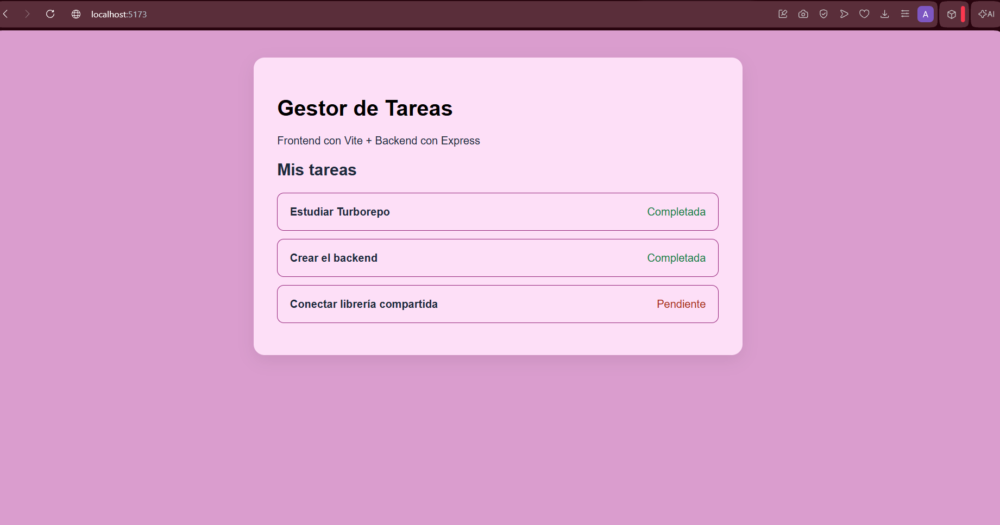
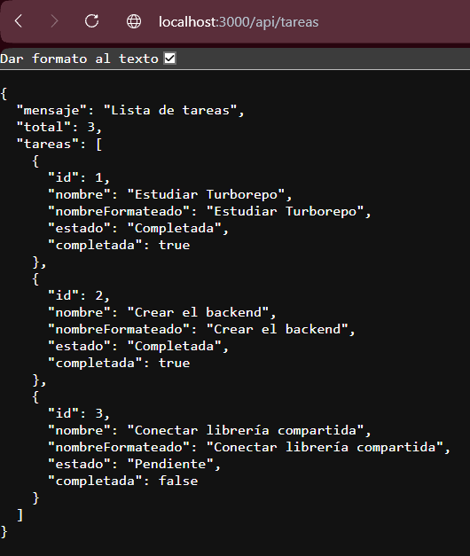

# Arquitectura de Sistemas 1
### Nombre
Ana Valeria Vicente Axpuac
### Carné
202408029
### Curso
Arquitectura de Sistemas 
### Semestre
6to semestre
### Carrera
Ingeniería en sistemas, informatica y ciencias de la comunicación

### Monorepo con Turborepo - HW 05

Monorepo desarrollado con Turborepo y npm workspaces. Contiene dos aplicaciones: un frontend con Vite y JavaScript y un backend con Node.js y Express. Ambas aplicaciones utilizan una librería compartida para procesar los nombres y estados de las tareas.

#### Estructura del monorepo

```text
arquitectura-de-sistemas/
├── apps/
│   ├── web/
│   │   ├── src/
│   │   ├── index.html
│   │   ├── vite.config.js
│   │   └── package.json
│   └── api/
│       ├── index.js
│       └── package.json
├── packages/
│   └── shared/
│       ├── index.js
│       ├── index.test.js
│       └── package.json
├── package.json
├── package-lock.json
├── turbo.json
└── README.md
```

La carpeta `apps/` contiene las aplicaciones frontend y backend, mientras que `packages/` contiene la librería compartida `@monorepo/shared`, utilizada por ambas aplicaciones.

#### Herramienta utilizada y justificación

Se utilizó **Turborepo** como herramienta para administrar el monorepo, junto con **npm workspaces** para gestionar las dependencias.

Se eligió Turborepo porque permite ejecutar, compilar y probar múltiples aplicaciones desde la raíz del repositorio, organizar las tareas y optimizar su ejecución mediante caché. Además, facilita la reutilización de código entre aplicaciones mediante paquetes compartidos.

#### Comandos disponibles

Los comandos se ejecutan desde la raíz del repositorio.

| Comando | Descripción |
|---|---|
| `npm install` | Instala las dependencias de todas las aplicaciones y paquetes |
| `npm run dev` | Ejecuta el frontend y el backend |
| `npm run dev:web` | Ejecuta el frontend de manera independiente |
| `npm run dev:api` | Ejecuta el backend de manera independiente |
| `npm run build` | Compila el frontend y verifica los demás paquetes |
| `npm run test` | Ejecuta las pruebas del monorepo |

#### Requisitos

Para ejecutar el proyecto es necesario tener instalado:

- Node.js compatible con la versión de Vite utilizada.
- npm.
- Git.

#### Instalación

Clonar el repositorio desde GitHub:

```bash
git clone URL_DEL_REPOSITORIO
```

Ingresar a la carpeta del proyecto:

```bash
cd arquitectura-de-sistemas
```

Cambiar a la rama correspondiente a esta entrega:

```bash
git switch hw-05
```

Instalar las dependencias desde la raíz:

```bash
npm install
```

#### Ejecución

Para iniciar ambas aplicaciones mediante Turborepo:

```bash
npm run dev
```

El frontend estará disponible en:

```text
http://localhost:5173
```

El backend estará disponible en:

```text
http://localhost:3000
```

Para ejecutar las aplicaciones de manera independiente:

Frontend:

```bash
npm run dev:web
```

Backend:

```bash
npm run dev:api
```

El frontend necesita que el backend esté ejecutándose para obtener la lista de tareas.

#### Compilación y pruebas

Para ejecutar la compilación y las verificaciones de los paquetes:

```bash
npm run build
```

Para ejecutar las pruebas:

```bash
npm run test
```

#### Evidencias de funcionamiento

**Frontend**



**Backend**



**Uso de la librería compartida**


